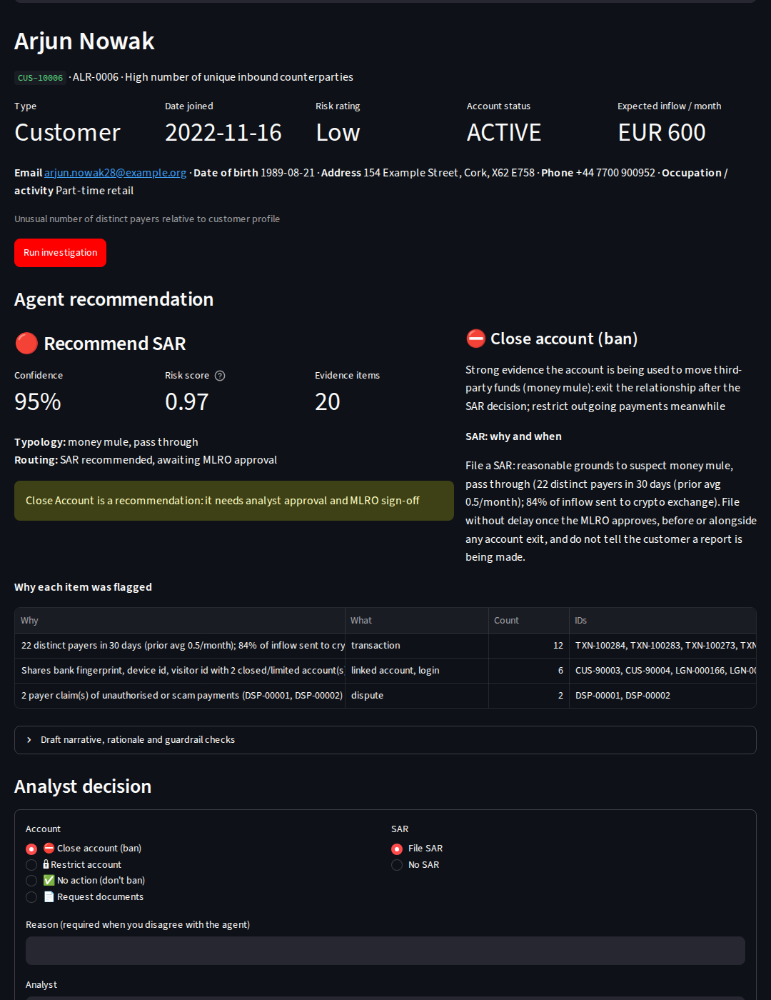
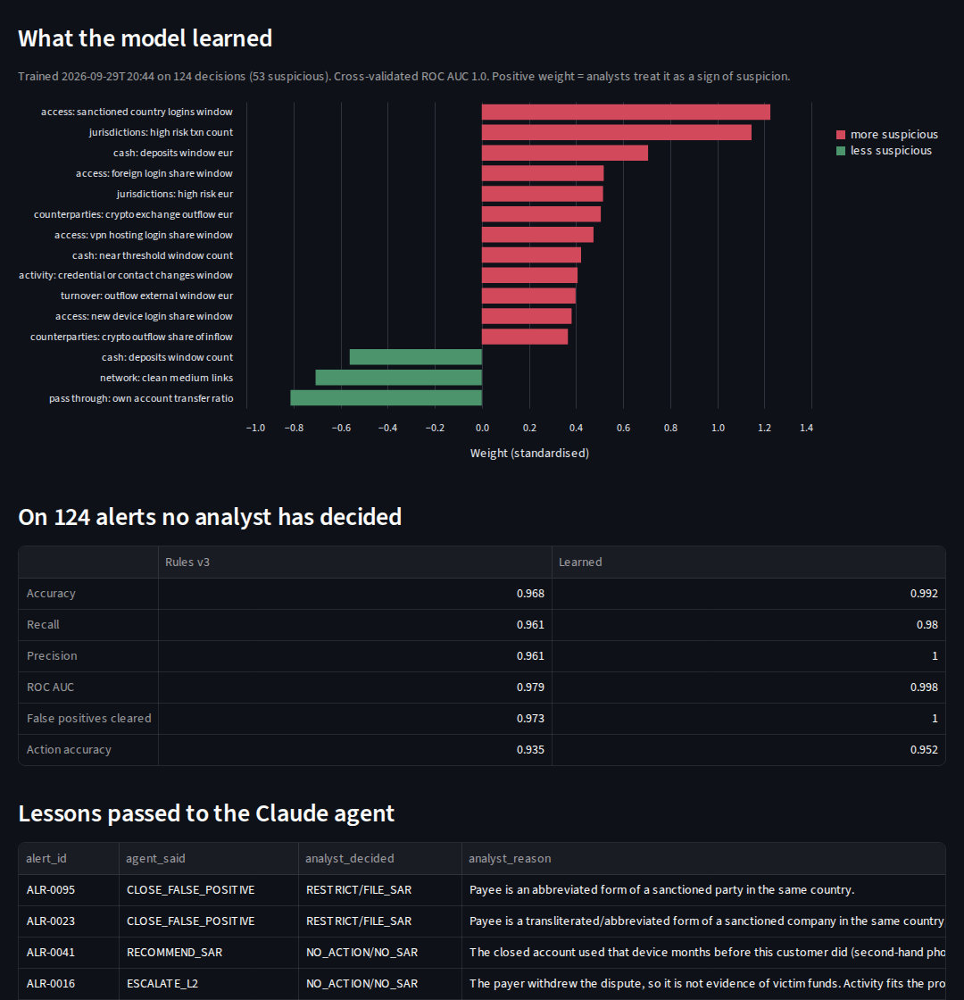
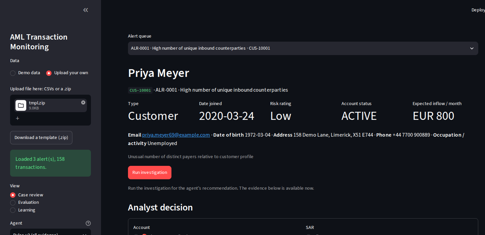

# AML Transaction Monitoring: Investigation Agent

An agentic AI workbench for AML alert investigation. You upload account data (or use the built-in demo). An agent investigates each alert the way an L1 analyst does and recommends:
- whether the activity is suspicious
- **what should happen to the account** (close/ban, restrict, request documents, or no action)
- **whether and when to file a SAR**
- **why each transaction, login, account change, dispute and linked account was flagged**

The analyst decides, and the system **learns from those decisions**.

It ships with the parts that make agentic AI usable in a regulated setting: **an evaluation harness against labelled ground truth (accuracy, precision, recall, F1, ROC AUC, action accuracy), deterministic guardrails, a full audit trail and a human-in-the-loop workbench.**

The agent recommends. People decide. It cannot ban an account, file a SAR, or contact a customer.



## From idea to app

The design started as an eight-slide sketch. Each slide maps to part of the app:

| Slide | Where it lives |
|---|---|
| 1. Upload file | Sidebar → **Upload your own**: CSVs or a .zip, with a downloadable template. Only `transactions.csv` is required; profiles and review alerts are built automatically when the other files are missing |
| 2. Profile: name, date joined, email, DOB, address, customer/merchant, type of business | Profile card at the top of every case |
| 3. Transactions: date, time, amount, to/from, dispute Y/N | **Transactions** tab (flagged rows marked ●) |
| 4. Last 10 logins with IP, VID, DID | **Logins & activity** tab: last 10 logins, login map, and account activity (financials added/removed, phone/email changes, password resets) |
| 5. Linked accounts via IP, VID, DID, financials | **Linked accounts** tab: network graph, link strength, linked accounts' status and prior SARs |
| 6. Financials: active, past, links to other users | **Financials** tab: active and removed bank accounts and cards, and every other account holding the same one |
| 7. Agent recommendation: why suspicious, ban or not, SAR why and when, documents, accuracy/AUC/recall | **Agent recommendation** panel, plus the **Evaluation** page |
| 8. Analyst decision (ban / not ban / ask for documents); agent learns | **Analyst decision** form, plus the **Learning** page |

## What the agent looks at

| Evidence | What it contains | What it tells the investigator |
|---|---|---|
| **Profile** | Customer or merchant, occupation/business type, DOB, address, expected monthly inflow, risk rating | What "normal" should look like |
| **Transactions** | 90 days compared with the customer's own history, with dispute flags | Structuring, pass-through, fan-in, crypto cash-out, high-risk jurisdictions |
| **Sanctions screening** | Fuzzy match of the customer and every counterparty, including near-misses | Direct exposure, transliterated names |
| **Logins** | IP, IP type (residential, mobile, public wi-fi, hosting/VPN), city, country, **device ID (DID)**, **visitor ID (VID)** | Has someone new taken control? Foreign or VPN access? |
| **Account activity** | Financials added/removed, phone/email changed, password resets, each with IP and device | Account sold, rented or taken over; a withdrawal account added, used and removed |
| **Linked accounts** | Accounts sharing a DID, VID, IP, phone, email or bank/card fingerprint, graded by strength | Part of a network we have already closed or reported? |
| **Financials** | Active and past bank accounts and cards, and other holders of each | Shared withdrawal accounts |
| **Disputes** | Payer claims (unauthorised, scam) and buyer claims, with status | Receiving victims' money? |

### Link strength: why a shared IP is not evidence on its own

| Identifier | Default strength | Why |
|---|---|---|
| Device ID, bank/card fingerprint, phone, email | **Strong** | Strangers rarely share them |
| Visitor ID (browser cookie) | **Medium** | Usually one person, but can be cleared or shared |
| IP in a small residential group (≤ 4 accounts) | **Medium** | A household or small office |
| Any other IP | **Weak** | Mobile carriers, public wi-fi and VPNs put many strangers behind one address |
| Anything shared by > 25 accounts | **Suppressed** | A "super-node" that links everyone to everyone |


## What the agent recommends

| Output | Example |
|---|---|
| Disposition | Close as false positive / Escalate to L2 / Recommend SAR, with confidence and a risk score |
| **Account action** | ⛔ Close account (ban) · 🔒 Restrict · 📄 Request documents · ✅ No action, with the reason |
| **Documents to request** | "Source of funds for the cash deposited", "Proof of identity (photo ID and a selfie) to confirm you are the account holder" |
| **SAR: why and when** | "File a SAR: reasonable grounds to suspect money mule activity (…). File without delay once the MLRO approves, before or alongside any account exit, and do not tell the customer a report is being made." |
| **Why each item was flagged** | Grouped by reason: the transactions, logins, account events, disputes and linked accounts behind each red flag |
| Narrative | SAR-style grounds for suspicion, with every ID and amount verified |

## Guardrails

| Guardrail | What it does |
|---|---|
| Citation grounding | Every transaction, login, event, dispute and linked-account ID cited must exist in this case |
| Amount grounding | Every EUR figure in the narrative must trace to the data |
| Evidence required | An escalation with no cited evidence is a violation |
| Sanctions policy | A strong sanctions match with a matching country can never be closed by the agent |
| **No automatic bans** | Restrict needs analyst approval; close account needs analyst approval and MLRO sign-off |
| **Consistent actions** | Recommending a ban on an alert the agent wants to close is flagged |
| **Tipping-off** | Document requests are checked for wording that reveals suspicion (suspicious, SAR, laundering, fraud, investigation, police…); any request during a suspicion review needs MLRO approval of the wording |
| Confidence gate | A close below 0.85 confidence goes to a human, not auto-close |
| No autonomous filing | SARs always wait for MLRO approval |

## Results

All agents are scored on the same labelled demo queue (248 alerts, 104 suspicious).

| Metric | Rules v1 (transactions) | Rules v2 (+ logins, network, disputes) | Rules v3 (+ account activity) |
|---|---|---|---|
| Accuracy | 87.1% | 95.6% | **96.4%** |
| Precision | 87.5% | 95.1% | 95.2% |
| Recall | 80.8% | 94.2% | **96.2%** |
| F1 | 84.0% | 94.7% | 95.7% |
| ROC AUC | 0.923 | 0.977 | **0.980** |
| Account-action accuracy | 81.0% | 91.1% | 91.1% |
| Restrict/close on a benign customer | 8.3% | 2.1% | 2.1% |
| System recall after guardrails | 100% | 100% | 100% |

What each layer fixed:
- **Logins, network and disputes (v2)** caught transliterated sanctioned names and mules who cash out to individuals. They also cleared students splitting rent with flatmates.
- **Account activity (v3)** caught the last "fresh" mules: accounts with no network and no complaints yet, but with a new device, a password reset and a phone change, followed by money flowing through.

What still fools the rules is planted deliberately:
- **A payer dispute that was later withdrawn** still counts as a victim claim.
- **A second-hand phone** (a closed account used the device months *before* this customer) still looks like a live link.
- **Sanctioned names abbreviated beyond recognition** with no other signal.

Rules count signals. They don't read a dispute's status or check whether two accounts used a device at the same time.

## Learning from analyst decisions



Every decision recorded in the **Analyst decision** form is a labelled example. The system learns from those decisions in two ways:

1. **A learned scorer.** A logistic regression over the same indicators the agents see, trained only on cases an analyst has decided. It is always scored on alerts **no analyst has touched**, never on its own training cases.
2. **Lessons for the Claude agent.** Cases where the analyst overruled the agent are given to the Claude agent as lessons, with the analyst's reason, for example: "The payer withdrew the dispute, so it is not evidence of victim funds", or "The closed account used that device months before this customer did (second-hand phone)".

Demo: a simulated analyst decides half the queue from the ground truth. The model trains on that half and is scored on the other half:

| On 124 held-out alerts | Rules v3 | Learned from analyst decisions |
|---|---|---|
| Accuracy | 96.8% | **99.2%** |
| Recall | 96.1% | **98.0%** |
| Precision | 96.1% | **100%** |
| ROC AUC | 0.979 | **0.998** |
| Account-action accuracy | 93.5% | **95.2%** |
| Restrict/close on a benign customer | 2.7% | **0%** |

The learned model cleared the withdrawn-dispute and second-hand-phone traps it had never seen. It did this because analysts closed similar cases and it had features for dispute status and for concurrent device use. When it disagrees with the rules, the case goes to a human with both views stated; it never auto-closes on its own say-so.

> **Read these numbers carefully.** The data, scenarios and rules were written by one person, so everything here is an optimistic upper bound. Synthetic scenarios are far more separable than real alerts: the cross-validated AUC of 1.0 is a warning sign, not a success. The model's top-weighted signal ("logins from a sanctioned country") is partly a fingerprint of how the data was generated. On real data, features like that are exactly what a model-risk review should test for leakage. The value is the method: labelled scenarios, planted traps, held-out scoring, and an itemised list of every miss. See the [model card](MODEL_CARD.md).

## Bring your own data



In the sidebar, choose **Upload your own** and drop in CSVs or a .zip. **Download a template** shows every file and column. Only `transactions.csv` (`txn_id, customer_id, timestamp, direction, amount_eur, counterparty_name`) is required.

Everything else is optional: `customers`, `alerts`, `logins`, `instruments`, `disputes`, `account_events`, `sanctions_list` and `ground_truth`. The app validates each file, names any missing columns, and fills safe defaults. Without `alerts.csv`, it creates one review case per customer. Field reference: [`docs/data_dictionary.md`](docs/data_dictionary.md).

## Run it

```bash
pip install -r requirements.txt
make all            # data, tests, rules v1-v3, learning demo, reports/comparison.md (about 1.5 minutes)
make app            # workbench at http://localhost:8501  (deep link: ?alert=ALR-0006)

export ANTHROPIC_API_KEY=...
make eval-claude    # the Claude agent, added to the comparison
```

### Windows (PowerShell)

```powershell
& "C:\Program Files\Python312\python.exe" -m venv .venv
Set-ExecutionPolicy -Scope Process -ExecutionPolicy Bypass
.\.venv\Scripts\Activate.ps1
pip install -r requirements.txt
$env:PYTHONPATH="src"
python -m amlagent.evaluate --agent baseline_v1 --no-audit
python -m amlagent.evaluate --agent baseline_v2 --no-audit
python -m amlagent.evaluate --agent baseline
python -m amlagent.learning simulate --share 0.5
python -m amlagent.learning train
python -m amlagent.evaluate --agent learned --no-audit
python -m amlagent.compare
streamlit run app.py
```

## Project layout

```
src/amlagent/
  data_gen.py              transactions, alerts, ground truth, sanctions list (v1)
  identity_gen.py          logins (IP/DID/VID), instruments, disputes, network accounts (v2)
  profile_gen.py           DOB, address, customer/merchant, past financials, account events, expected actions (v3)
  tools.py                 investigation tools and link analysis: the agent's only view of the data
  agents/baseline.py       rules: v1 transactions, v2 + logins/network/disputes, v3 + account activity
  agents/claude_agent.py   Claude tool-use agent, with analyst lessons
  learning.py              analyst decisions, learned scorer, held-out evaluation, lessons for the LLM
  guardrails.py            grounding, evidence, sanctions, no automatic bans, tipping-off, confidence gate
  upload.py                validate and complete uploaded files; template
  evaluate.py / compare.py accuracy, precision, recall, F1, ROC AUC, action accuracy; side-by-side comparison
  audit.py                 append-only per-alert audit log
app.py                     Streamlit workbench (case review, evaluation, learning)
tests/                     28 tests: guardrails, agent loop (scripted fake LLM), link analysis, uploads, learning
MODEL_CARD.md              intended use, limitations, failure modes, privacy, fairness, learning governance
docs/                      data dictionary, narrative QA rubric, product notes, screenshots
```

All demo identifiers are safe to publish. IPs come from reserved documentation and benchmark ranges, phone numbers from the UK's reserved drama range (+44 7700 900xxx), emails use example.com/.org/.net, addresses use "Example"/"Sample" streets, and all people, companies and sanctioned parties are fictional.
