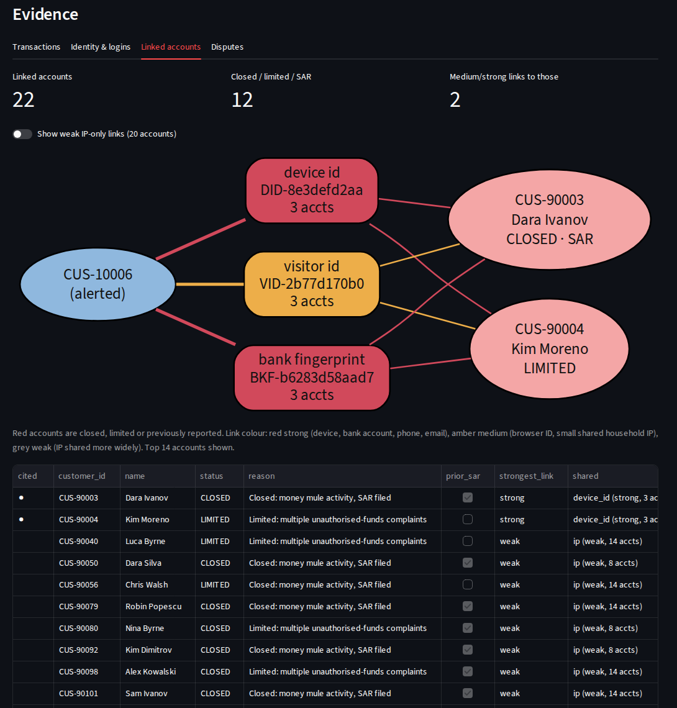
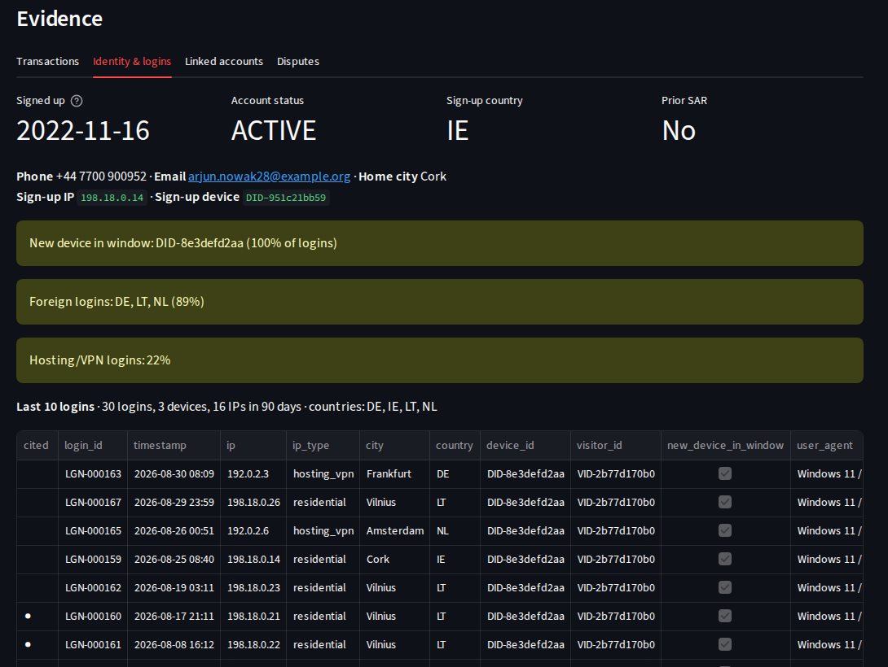

# AML Investigation Agent

An agentic AI system that investigates transaction-monitoring alerts the way an L1 AML analyst does. It reads the transactions, **who is operating the account** (logins, IPs, devices), **who the account is connected to** (shared devices, bank accounts, phones, IPs), and **who is complaining about it** (disputes). It then recommends a disposition with a cited evidence trail and hands the case to a human.

It ships with the parts that make agentic AI usable in a regulated setting: **an evaluation harness against labelled ground truth, deterministic guardrails, a full audit trail, and a reviewer workbench.**

The agent recommends. People decide. It cannot close a case, file a SAR, or act on an account.



*An alerted account sharing a device, a browser ID and a withdrawal bank account with two mule accounts that were already closed or limited. Weak IP-only links are hidden by default.*

## Why this exists

Alert investigation is still the most manual part of most AML programmes. The analyst pulls the KYC profile, reads 90 days of transactions, checks the login history, opens the link-analysis screen, screens counterparties, looks for a benign explanation, and writes a narrative. Agentic AI can do much of that groundwork.

The hard part is not getting a model to produce an answer. It is **knowing whether the answer is right, proving it to an auditor, and making sure the failures land in front of a human.** This project is built around that problem.

## What the agent looks at

| Evidence | What it contains | What it tells the investigator |
|---|---|---|
| **KYC profile** | Occupation or business, expected monthly inflow, risk rating | What "normal" should look like for this customer |
| **Transactions** | 90 days, compared with the customer's own history | Structuring, pass-through, fan-in, crypto cash-out, high-risk jurisdictions |
| **Sanctions screening** | Fuzzy match of the customer and every counterparty, including near-misses | Direct exposure, transliterated names |
| **Identity** | Sign-up date, sign-up IP, device and country, phone, email, account status, prior SAR | Account age, how and where it was opened |
| **Login history** | Last N logins: time, IP, IP type (residential, mobile, public wi-fi, hosting/VPN), city, country, **device ID (DID)**, **visitor ID (VID)** | Has someone new taken control? Foreign or VPN access? Logins from a sanctioned country? |
| **Linked accounts** | Other accounts sharing a **DID, VID, IP, phone, email or bank account/card fingerprint**, with each link's strength and each account's status | Is this account part of a network we have already closed or reported? |
| **Disputes** | Payer claims (unauthorised, scam) and buyer claims (item not received), with status | Is this account receiving victims' money? |

### Link strength: why a shared IP is not evidence on its own

| Identifier | Default strength | Why |
|---|---|---|
| Device ID, bank account / card fingerprint, phone, email | **Strong** | Strangers rarely share them |
| Visitor ID (browser cookie) | **Medium** | Usually one person, but can be cleared or shared |
| IP in a small residential group (≤ 4 accounts) | **Medium** | A household or small office |
| Any other IP | **Weak** | Mobile carriers, public wi-fi and VPNs put many strangers behind one address |
| Anything shared by > 25 accounts | **Suppressed** | A "super-node" such as carrier NAT, which links everyone to everyone |

Link-analysis tools that skip this step flag every student house and every mobile user. The dataset tests for it: flatmates share an IP and pay each other rent, restaurant staff use the office wi-fi, and some customers use a privacy VPN.

## Results

Both rules-based agents were run on the same 248 alerts. v1 sees transactions only; v2 adds identity, network and dispute evidence.

| Metric | Rules v1 (transactions) | Rules v2 (+ identity, network, disputes) |
|---|---|---|
| **Model recall** | 80.8% | **94.2%** |
| System recall after guardrails | 100% | 100% |
| False-positive clearance | 91.7% | **96.5%** |
| Escalation precision | 87.5% | **95.1%** |
| Typology accuracy | 90.5% | **98.0%** |
| Guardrail violations | 0% | 0% |

Where the new evidence made the difference:

| Scenario | v1 | v2 | What changed |
|---|---|---|---|
| Sanctioned party paid under a transliterated name | 0% | **83%** | Near-miss screening score plus logins from a sanctioned country |
| Money mule cashing out to individuals, not crypto | 58% | **83%** | Device and bank account shared with closed mule accounts; payer scam claims |
| Students splitting rent with friends (benign) | 0% cleared | **75% cleared** | Payers share the student's home IP and are clean accounts: a household, not a network |

What still breaks, and why this points at the LLM agent:

- **A withdrawn dispute counts as a victim claim.** The rule counts payer claims and doesn't read their status. That produced 3 of the 5 false positives.
- **A second-hand phone looks like a mule link.** A closed account used the device months before this customer did. The rule sees a strong link to a SAR-filed account and doesn't check timing (2 false positives).
- **Sanctioned names abbreviated beyond recognition, with no other signal.** Examples are `Boris A. Kren` and `Severny Veter` for "Northwind" (4 misses, all routed to a human).
- **Fresh mules with no history yet.** They have a new device but no network, no complaints and no crypto, so there is nothing for a rule to find (2 misses, both routed to a human).

Each of these needs the agent to read context (dispute status, when each account used the device), not just count signals. That's the job the Claude agent is there to do. `make eval-claude` puts it in the same comparison table.

> **Read these numbers carefully.** The data, the scenarios and the rules were all written by the same author, so rules-based results here are an optimistic upper bound. The value is the method: labelled scenarios, per-scenario breakdowns, planted traps, and an itemised list of every miss. See the [model card](MODEL_CARD.md).

## Reviewer workbench



For every alert the reviewer sees:
- the recommendation, confidence, routing and guardrail checks
- the draft narrative
- four evidence tabs:
  - **Transactions**
  - **Identity & logins**: the last 10 logins and a login map
  - **Linked accounts**: a network graph, the linked-accounts table, suppressed identifiers, and bank accounts on file with every other account that holds the same one
  - **Disputes**

Every cited item is marked with ●. Overrides need a reason and are written to the audit trail.

To open an alert directly, use `http://localhost:8501/?alert=ALR-0006`.

## Guardrails

| Guardrail | What it does |
|---|---|
| Citation grounding | Every transaction, login, dispute and linked-account ID cited must exist and belong to this case |
| Amount grounding | Every EUR figure in the narrative must trace to a transaction, a sum of cited transactions, or a tool output |
| Evidence required | An escalation with no cited evidence is a violation |
| Sanctions policy | A strong sanctions match with a matching country can never be closed by the agent |
| Confidence gate | A close below 0.85 confidence goes to a human, not auto-close |
| No autonomous filing | SAR recommendations always wait for MLRO approval |

## Data

Synthetic data, generated by [`data_gen.py`](src/amlagent/data_gen.py) (transactions) and [`identity_gen.py`](src/amlagent/identity_gen.py) (identity, logins, devices, instruments, disputes, network accounts). The identity layer uses its own random stream, so the v1 transactions are byte-for-byte unchanged and the two versions compare fairly.

- 248 alerts, 386 customers (138 of them network accounts outside the queue), ~12,000 transactions, ~6,000 logins, ~570 bank accounts and cards, ~130 disputes
- 7 suspicious and 7 benign scenarios, each with a standard and a harder variant, plus planted real-world noise: privacy VPN users, second-hand phones, withdrawn disputes, public wi-fi, carrier NAT
- All identifiers are safe to publish. IPs come from reserved documentation and benchmark ranges, phone numbers from the UK's reserved drama range (+44 7700 900xxx), emails use example.com/.org/.net, and all names and entities are fictional

Field-by-field reference: [`docs/data_dictionary.md`](docs/data_dictionary.md).

## Run it

```bash
pip install -r requirements.txt
make all            # generate data, run tests, evaluate v1 and v2, write reports/comparison.md
make app            # reviewer workbench at http://localhost:8501

export ANTHROPIC_API_KEY=...
make eval-claude    # evaluate the Claude agent and add it to the comparison
```

On Windows without `make`, see [Windows setup](#windows-setup).

## Project layout

```
src/amlagent/
  data_gen.py              transactions, alerts, ground truth, sanctions list
  identity_gen.py          identity, logins (IP/DID/VID), instruments, disputes, network accounts
  tools.py                 investigation tools and link analysis (the agent's only view of the data)
  agents/claude_agent.py   Claude tool-use agent
  agents/baseline.py       deterministic L1 procedure (v1: transactions; v2: + identity/network/disputes)
  guardrails.py            grounding, evidence, sanctions policy, confidence gate
  audit.py                 append-only per-alert audit log
  evaluate.py              metrics, per-scenario breakdown, miss analysis, report
  compare.py               side-by-side comparison of every evaluated agent
app.py                     Streamlit reviewer workbench
tests/                     guardrails, agent loop (scripted fake LLM), identity and link analysis
MODEL_CARD.md              intended use, limitations, failure modes, privacy and fairness
docs/                      data dictionary, narrative QA rubric, product notes
```

## Windows setup

```powershell
& "C:\Program Files\Python312\python.exe" -m venv .venv
Set-ExecutionPolicy -Scope Process -ExecutionPolicy Bypass
.\.venv\Scripts\Activate.ps1
pip install -r requirements.txt
$env:PYTHONPATH="src"
python -m amlagent.data_gen
python -m amlagent.evaluate --agent baseline_v1 --no-audit
python -m amlagent.evaluate --agent baseline
python -m amlagent.compare
streamlit run app.py
```
